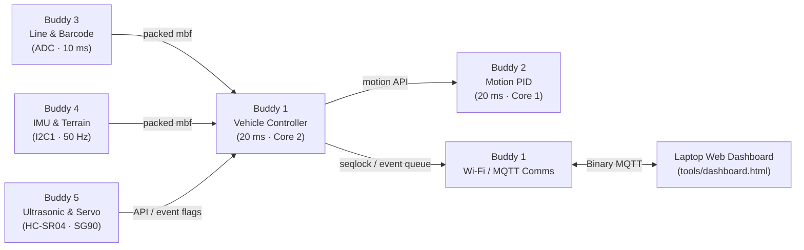
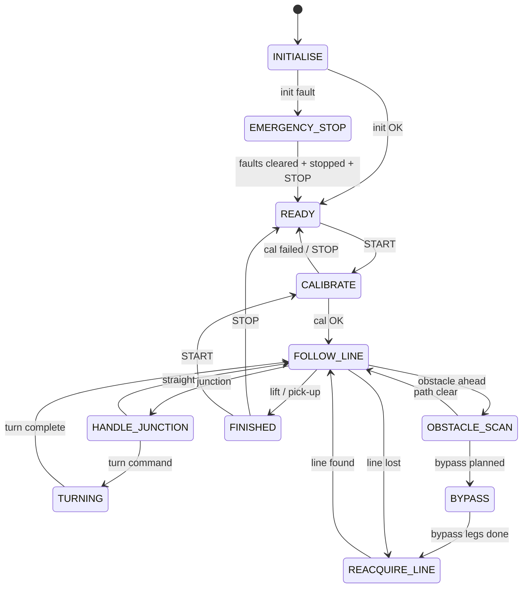

<div align="center">

# AAI06 Autonomous Robotic Car

**Autonomous line-following, barcode-guided, obstacle-avoiding robotic car**<br>
Built on **Raspberry Pi Pico W (RP2040)** + **Cytron ROBO-PICO** running **µT-Kernel 3.0 Dual-Core SMP**

[](docs/PORT_RP2040.md)
[](docs/GETTING_STARTED.md)
[](#1-project-overview--team)
[](docs/BINARY_FORMAT.md)
[-d29922?style=flat-square)](#8-system--acceptance-test-cases-with-video-proof)

<br>

[](https://www.youtube.com/watch?v=cULEqP0cqxU)

**[▶ Watch Full Autonomous Test Run on YouTube](https://www.youtube.com/watch?v=cULEqP0cqxU)** · **[📄 Full Test Cases Document (25 Cases)](docs/AAI06_Test_Cases.docx)** · **[📚 Project Docs](docs/project/README.md)**

</div>

---

The car calibrates its sensors on-board at every `START`, follows lines through bends, gaps, and junctions, decodes speed-independent Code 39 barcodes, measures terrain humps and lift events using an onboard IMU, scans and bypasses obstacles with a servo-mounted ultrasonic sensor, and streams compact binary telemetry over Wi-Fi / MQTT to a live web dashboard.

### Quick Navigation

1. [Project Overview & Team](#1-project-overview--team)
2. [Requirements (FR1–FR15 & NFR1–NFR8)](#2-requirements)
3. [Engineering Methodology: Sensor-Driven Learning](#3-engineering-methodology-sensor-driven-learning-over-hardcoding)
4. [System Architecture, State Machine & Pin Map](#4-system-architecture--hardware)
5. [Standout Features by Buddy](#5-standout-features-by-buddy)
6. [Change Requirement 1 (CR1): Minimum-Bit Representation](#6-change-requirement-1-cr1-minimum-bit-representation--binary-telemetry)
7. [Change Requirement 2 (CR2): Safe & Predictable Fault Handling](#7-change-requirement-2-cr2-safe--predictable-fault-handling)
8. [System & Acceptance Test Cases (B1-T1 – B5-T5)](#8-system--acceptance-test-cases-with-video-proof)
9. [Build, Flash & Repository Guide](#9-build-flash--repository-guide)

---

## 1. Project Overview & Team

- **Team:** AAI06
- **Platform:** Raspberry Pi Pico W (dual Cortex-M0+, no FPU, 2 MB flash) + Cytron ROBO-PICO
- **RTOS:** µT-Kernel 3.0 (IEEE 2050-2018) dual-core SMP port
- **Language & Standard:** Embedded C following BARR-C:2018, integer/fixed-point arithmetic in real-time loops

| Buddy | Member | Subsystem | Primary Ownership |
| --- | --- | --- | --- |
| **Buddy 1** | 2503151 | Vehicle Controller & Comms | Top-level state machine (`vc.c`, `vc_task.c`), Wi-Fi/MQTT stack (`comms.c`, `comms_codec.c`), live web dashboard (`tools/dashboard.html`) |
| **Buddy 2** | 2500770 | Motion Control | Dual DC motors, quadrature wheel encoders, closed-loop PID speed control, straight-line correction, encoder-based turning (`motion_*.c`) |
| **Buddy 3** | 2501386 | Line & Barcode Sensing | Dual IR line-following sensors, startup & in-run threshold adaptation, junction detection, Code 39 barcode capture & decoding (`line_follow.c`, `barcode.c`, `buddy3_task.c`) |
| **Buddy 4** | 2500847 | IMU & Terrain | LSM303DLHC accelerometer over I2C1, stationary calibration, hump/ramp peak height estimation, motion classification, encoder-derived turn rate, lift/pick-up detection (`b4_*.c`) |
| **Buddy 5** | 2500831 | Ultrasonic & Obstacle Avoidance | HC-SR04 ultrasonic sensor + SG90 servo scan (60°–120°), obstacle profiling (distance, angle, width, clearances), bypass planning & line recovery (`obstacle_*.c`) |

---

## 2. Requirements

### Functional Requirements (FR1–FR15)

| ID | Functional Requirement |
| --- | --- |
| **FR1** | The car shall follow a continuous line using two IR reflectance sensors, updating steering every 20 ms. |
| **FR2** | On `START`, the car shall calibrate by pivoting across the line to learn the centre and right line sensors' black/white thresholds and the IMU noise floor before driving. If calibration fails (insufficient contrast, line not found, a white gap between the sensors, or the IMU not ready), stop and return to `READY`. |
| **FR3** | The car shall detect junctions and turn according to the most recently read barcode command. |
| **FR4** | The car shall detect and decode Code 39 barcodes (e.g. `A` = left, `F` = right, `Z` = straight, `X` = U-turn) by encoder distance, independent of speed. |
| **FR5** | The car shall detect an obstacle ahead with the ultrasonic sensor and stop before contact (≤ 200 mm). |
| **FR6** | The car shall autonomously bypass a detected obstacle and reacquire the line. |
| **FR7** | The car shall detect ramps / humps and measure the hump height within ±5 mm. |
| **FR8** | The car shall accept `Start` and `Stop` commands wirelessly from the laptop over Wi-Fi / MQTT. |
| **FR9** | The car shall publish line, motion, terrain, state, and event telemetry wirelessly at 10 Hz during a run. |
| **FR10** | The car shall emit a heartbeat at ≥ 1 Hz so the operator can detect loss of connection. |
| **FR11** | On losing the line, the car shall pivot to search (≤ 90° per side) and resume, or fail safe after ≤ 9 s. |
| **FR12** | The car shall enter `EMERGENCY_STOP` on any serious fault (stall, encoder, motion-command, ultrasonic) and require an operator `STOP` to restart. |
| **FR13** | The car shall stop the motors and finish the run when the car is lifted (pick-up detection) and allow a restart. |
| **FR14** | Once started, the car shall complete the course without laptop input; loss of Wi-Fi shall not interrupt driving. |
| **FR15** | While bypassing an obstacle, the car shall estimate the obstacle's width by watching its face with the ultrasonic sensor until it passes the edge, and report the estimate to the dashboard. |

<details>
<summary><strong>Non-Functional Requirements (NFR1–NFR8)</strong> — click to expand</summary>

<br>

| ID | Non-Functional Requirement |
| --- | --- |
| **NFR1** | The control loop shall run on a fixed 20 ms period, in lock-step with the motion loop. |
| **NFR2** | The car shall cruise at 100 mm/s on straights, reduced automatically to ~50 mm/s at full steer. |
| **NFR3** | Use a compact binary MQTT codec: high-rate telemetry at QoS 0, events at QoS 1 (`state` and `summary` retained), each payload version-tagged. |
| **NFR4** | On Wi-Fi loss, the car shall auto-reconnect (`re-associate → DHCP → MQTT → re-subscribe`) without stopping, retrying after 1 s and then every 5 s; drops and rejoins shall be observable. |
| **NFR5** | Each task's output shall have a single writer, shared as a packed word via a message buffer or a sequence-counted / mutex-guarded snapshot; no task writes another task's data. |
| **NFR6** | The software shall run on µT-Kernel 3.0 SMP on the RP2040 (Pico W) with a USB-CDC console. |
| **NFR7** | Each peripheral shall have a single owner (radio, I2C1 / IMU, ADC / IR, ultrasonic, servo, motors / encoders). |
| **NFR8** | The car shall brake both motors within one control cycle (≤ 20 ms) on a serious fault and latch until acknowledged. |

</details>

---

## 3. Engineering Methodology: Sensor-Driven Learning Over Hardcoding

A core design principle across the project was to **learn from onboard sensors rather than hardcoding wherever possible**, so changes in lighting, tape contrast, battery voltage, or track geometry do not break the car.

| Area | Avoided Hardcoding | Sensor-Driven Approach |
| --- | --- | --- |
| **Startup (`CALIBRATE`)** | Fixed IR thresholds & manual tuning | Pivots across the line on every `START` to learn black/white thresholds, contrast margins, and IMU noise floor; aborts to `READY` if checks fail. |
| **Line Following** | Static light/dark cutoffs | Centre IR adapts its reference threshold in-run for fading tape/dark patches; right IR floors at its calibrated `START` level to prevent false junctions. |
| **Barcode Decoding** | Time-based bar widths | Measures bar/space widths in **wheel-encoder counts along the sensor's arc**, keeping Code 39 ratios accurate regardless of speed. |
| **Terrain & Lift (IMU)** | Hardcoded 10 mm ramp height & static tilt cutoffs | Learns level baseline and driving noise floor on-car; computes hump height from lateral tilt and the 115 mm tyre-track lever, and separates lifts from normal driving. |
| **Obstacle Bypass** | Assumed obstacle width & clearances | Runs a 60°–120° servo sweep (15° steps) for distance and clearances, then watches the obstacle face during bypass until passing its edge to estimate width. |
| **Verification** | Blind trial-and-error flashes | Uses host unit tests (`tests/`), an onboard RAM run recorder (`VC_RECORDER=1` via OpenOCD), and offline replays to validate fixes. |

---

## 4. System Architecture & Hardware

### Software Architecture

The firmware follows a strict **sensors report → Vehicle Controller arbitrates → Motion executes** architecture on µT-Kernel 3.0 dual-core SMP (10 ms kernel tick, 20 ms control loop):



- **Zero dynamic allocation at runtime:** All tasks, stacks, message buffers, mutexes, and ring buffers are statically allocated.
- **Single-owner peripherals:** No two tasks ever touch the same hardware peripheral.
- **Decoupled observability:** Wi-Fi/MQTT runs at lower priority outside the 20 ms control loop so network latency or dropouts never affect driving.

<details>
<summary><strong>Vehicle Controller State Machine (<code>vc.c</code>)</strong> — click to expand</summary>

<br>



</details>

### Hardware & Pin Map (ROBO-PICO + Pico W)

| Subsystem | Peripheral | GPIO Pins | Notes |
| --- | --- | --- | --- |
| **Motors (Left / Right)** | PWM (20 kHz, MX1508) | GP8/GP9 (L), GP10/GP11 (R) | Active-low inverted inputs; 1 A cont. / 1.5 A peak |
| **Encoders (Left / Right)** | GPIO Quadrature | GP16/GP17 (L), GP4/GP5 (R) | ~14.0 counts/mm (~2536 / 2529 counts/rev) |
| **Line IR Sensors** | ADC0 / ADC1 | GP26 (Right), GP27 (Centre) | Side-by-side ahead of front caster |
| **Barcode IR Sensor** | ADC2 | GP28 | Mounted on left arm beside the line |
| **IMU (LSM303DLHC)** | I2C1 (400 kHz) | GP2 (SDA), GP3 (SCL) | Grove 2; accelerometer `0x19` |
| **Ultrasonic (HC-SR04)** | GPIO Trig / Echo | GP0 / GP1 | Grove 1 (console moved to USB-CDC) |
| **Scan Servo** | PWM | GP12 | S1 header |
| **Wi-Fi (CYW43439)** | Internal SPI | GP23, GP24, GP25, GP29 | Reserved by Pico W radio |

---

## 5. Standout Features by Buddy

| Buddy | Key Engineering Highlights |
| --- | --- |
| **Buddy 1**<br>*VC, Comms & Dashboard* | • Pure-logic 11-state controller (`INITIALISE`, `READY`, `CALIBRATE`, `FOLLOW_LINE`, `HANDLE_JUNCTION`, `TURNING`, `OBSTACLE_SCAN`, `BYPASS`, `REACQUIRE_LINE`, `FINISHED`, latched `EMERGENCY_STOP`).<br>• Dual-format MQTT codec (`comms_codec.c`): compact binary by default (~78% smaller than JSON) with compile-time JSON fallback (`COMMS_FORMAT=json`).<br>• Resilient auto-reconnect (`Wi-Fi → DHCP → MQTT → re-subscribe`) that never blocks driving, plus live web dashboard (`tools/dashboard.html`). |
| **Buddy 2**<br>*Motion Control* | • Closed-loop dual-wheel PID at 20 ms with feed-forward, slew-rate limiting, and straight-line correction.<br>• High-resolution quadrature odometry (~14.0 counts/mm, ~0.07 mm/count) for repeatable distance and encoder-based pivot/turn manoeuvres.<br>• Built-in safety: per-wheel stall detection, encoder plausibility & invalid-transition checks, manoeuvre timeouts, and zero-drift active braking. |
| **Buddy 3**<br>*Line & Barcode* | • Self-calibrating dual-IR tracking at `START` with in-run dark-patch reference recovery (`ref_threshold`) and last-seen-side line-loss pivot search.<br>• Angle-tolerant junction detection with early 90° turn catch on line reacquisition and queued barcode execution.<br>• Arc-compensated Code 39 barcode decoder using encoder travel along the left sensor's arc, applying navigation mappings configured over MQTT `MAP` (e.g. `A`/`F`/`Z`/`X`). |
| **Buddy 4**<br>*IMU & Terrain* | • Physics-based hump height estimation from lateral tilt on the LSM303DLHC accelerometer and the 115 mm tyre-track lever (0.1 mm resolution, run maximum tracked).<br>• Learned stationary/driving noise floor + 10-sample confirmation rejects motor startup/steering jolts (< 6 samples) on flat runs.<br>• Encoder-derived turn rate (115 mm track, zero magnetometer drift) and pick-up/lift detection that stops both motors and transitions to `FINISHED`. |
| **Buddy 5**<br>*Ultrasonic & Obstacle* | • Bounded 60°–120° servo scan in 15° steps (3 pings/angle) to profile obstacle distance, angle, and side clearances, plus post-pivot path check.<br>• Bypass edge-width estimation: watches the obstacle's face with the ultrasonic sensor during bypass leg 1 until passing its edge and reports the estimate to the dashboard.<br>• Autonomous multi-leg encoder-guided bypass (or safe stop if blocked) handing cleanly back to line reacquisition. |

---

## 6. Change Requirement 1 (CR1): Minimum-Bit Representation & Binary Telemetry

CR1 required every application data field to use only the bits its valid range needs, with a shared fault bitmask, compact binary MQTT payloads, and race-free shared records—without changing behaviour or timing.

- **Explicit masks & shifts only:** Packed into fixed-width unsigned words (`uint8_t` / `uint16_t` / `uint32_t`)—no C bit-fields (BARR-C:2018 5.5.b).
- **Full-width math, packed storage:** PID, filters, and estimators compute in full-width locals; only stored, shared, queued, ring-buffered, and transmitted data is packed.
- **Race-free concurrency:** Single-writer 32-bit atomic stores for single-word records; seqlocks or mutex-guarded packed snapshots for multi-word records.
- **Saturation & validation:** Out-of-range measurements clamp cleanly; unknown enum codes are rejected.

> [!NOTE]
> The on-wire binary MQTT field layouts, bit widths, and decoder tables are documented in [`docs/BINARY_FORMAT.md`](docs/BINARY_FORMAT.md).

---

## 7. Change Requirement 2 (CR2): Safe & Predictable Fault Handling

> *"If any part of the system fails or provides invalid data, the system must respond in a safe and predictable way."*

Much of our architecture already enforced fail-safe handling in firmware; Tribunal 2 audited all 17 failure modes across every subsystem.

### Already Implemented in Firmware
- **Unified latched `EMERGENCY_STOP` (`vc.c`, `vc_task.c`):** Any serious fault (`STALL`, `ENCODER`, `MOTION_CMD`, `ULTRASONIC`) triggers Rule 1 in `step_checked()`, requesting `motion_stop()` in the same 20 ms control cycle and latching until the fault clears, the car is stationary, and the operator explicitly sends `STOP`.
- **Stale / missing sensor protection:** Sensor inputs carry timestamps/validity; stale or missing data is rejected rather than treated as valid.
- **Graceful degradation on non-critical failures:**
  - **Wi-Fi / MQTT loss:** Driving continues autonomously while comms reconnects in the background.
  - **IMU fault / stale terrain data:** Raises fault bit 3 (non-serious), blocks `START` while unready, keeps driving if lost mid-run, retries I2C1 every 500 ms, and marks affected hump heights invalid.
- **Invalid barcode rejection (`barcode.c`):** Malformed or overflowed captures are discarded before the Vehicle Controller can act on them.
- **Motion safety checks (`motion_task.c`):** Per-wheel stall detection, encoder plausibility & invalid-transition checks, finite manoeuvre timeouts, and RP2040 watchdog-tick timebase initialisation.
- **Pick-up stop & calibration gating:** Lifting the car stops both motors and enters `FINISHED`; `CALIBRATE` refuses to drive if IR contrast is insufficient, no line is found, or the IMU is not ready.
- **Static allocation only:** Zero dynamic heap allocation at runtime prevents fragmentation and OOM crashes.

<details>
<summary><strong>Tribunal 2 Future Hardening Proposals (7 design-stage items)</strong> — click to expand</summary>

<br>

1. Detecting a stuck-high ultrasonic Echo pin (3 consecutive stuck readings → `SENSOR_FAULT` → `EMERGENCY_STOP`).
2. Cross-checking ultrasonic distance against encoder travel when driving straight (≥ 100 mm) to catch a frozen-value sensor.
3. Replacing the unbounded mutex wait in `motion_stop()` with a bounded emergency-stop path.
4. Adding a 60 ms velocity-command refresh watchdog (3 missed 20 ms updates → brake).
5. Verifying an independent hardware motor-disable path if a PWM/brake write fails.
6. Adding an explicit startup timebase-advancement check before enabling motors.
7. Enabling the RP2040 hardware watchdog gated on all safety-critical tasks reporting healthy.

</details>

---

## 8. System & Acceptance Test Cases (with Video Proof)

> [!TIP]
> **Video Proof:** [Watch the continuous integrated test run on YouTube](https://www.youtube.com/watch?v=cULEqP0cqxU) demonstrating startup calibration, line following, barcode decoding & junction turning, hump traversal, obstacle bypass, live MQTT telemetry, and pick-up stop.<br>
> **Full Test Procedures:** [`docs/AAI06_Test_Cases.docx`](docs/AAI06_Test_Cases.docx) contains the Master Traceability & Sign-Off Matrix, detailed test steps, expected results, and dashboard verification criteria for all 25 test cases.

### Test Coverage Overview

| Buddy | Subsystem | Test IDs | Focus |
| --- | --- | --- | --- |
| **Buddy 1** | Wi-Fi, MQTT & Vehicle Controller | `B1-T1` – `B1-T5` | Connectivity, live telemetry, remote commands, heartbeat, auto-recovery |
| **Buddy 2** | Motors & Wheel Encoders | `B2-T1` – `B2-T5` | PID speed, distance accuracy, bend steering, turning, zero-drift stop |
| **Buddy 3** | Line Following & Barcode Sensing | `B3-T1` – `B3-T5` | IR calibration, line following/recovery, barcode detect/decode, junctions |
| **Buddy 4** | IMU & Terrain Sensing | `B4-T1` – `B4-T5` | IMU calibration, hump height, peak tracking/flat rejection, turn rate, pick-up |
| **Buddy 5** | Ultrasonic & Obstacle Avoidance | `B5-T1` – `B5-T5` | Forward stop, servo scan, width/clearances, bypass planning, line rejoin |

<details>
<summary><strong>Buddy 1 — Wi-Fi, MQTT & Vehicle Controller (B1-T1 – B1-T5)</strong></summary>

<br>

| ID | Type | Test Title | Verified Capability |
| --- | --- | --- | --- |
| **B1-T1** | Nominal | WiFi & MQTT Connection Establishment | Establish Wi-Fi & MQTT connectivity on boot |
| **B1-T2** | Nominal | Live Telemetry Publishing via MQTT | Stream live telemetry to dashboard panels & charts |
| **B1-T3** | Nominal | Remote Command Subscription (Start / Stop / Stop → Start) | Subscribe to and execute remote `START`/`STOP` commands |
| **B1-T4** | Boundary | Heartbeat & Robot Status Reporting | Report 1 Hz heartbeat, state, fault mask & build info |
| **B1-T5** | Off-Nominal | Connection Loss & Automatic Recovery | Continue driving on link drop and auto-reconnect |

</details>

<details>
<summary><strong>Buddy 2 — Motors & Wheel Encoders (B2-T1 – B2-T5)</strong></summary>

<br>

| ID | Type | Test Title | Verified Capability |
| --- | --- | --- | --- |
| **B2-T1** | Boundary | Straight-Line Motion & PID Speed Control | Consistent cruise speed & straight-line correction |
| **B2-T2** | Boundary | Encoder Distance Estimation Accuracy | Accurate `dist_mm` odometry against measured travel |
| **B2-T3** | Nominal | Smooth Differential Steering on Bends | Stable curved motion & slow inner-wheel PID tracking |
| **B2-T4** | Nominal | Repeatable Encoder-Based Turning | Accurate left, right, and in-place pivot turns |
| **B2-T5** | Off-Nominal | Clean Motor Stop & Zero Drift | `stop()` halts both wheels cleanly with no creep |

</details>

<details>
<summary><strong>Buddy 3 — Line Following & Barcode Sensing (B3-T1 – B3-T5)</strong></summary>

<br>

| ID | Type | Test Title | Verified Capability |
| --- | --- | --- | --- |
| **B3-T1** | Boundary | IR Sensor Calibration & Line Position Estimation | Calibrate IR thresholds on `START`; reject no-line start |
| **B3-T2** | Nominal | Continuous Line Following & Line-Loss Recovery | Follow straights, bends, and recover from line loss |
| **B3-T3** | Nominal | Detect a Barcode Along the Track | Detect barcode pattern while driving past |
| **B3-T4** | Nominal | Decode the Barcode & Obtain the Code | Decode Code 39 character to navigation command |
| **B3-T5** | Nominal | Junction Detection & Follow Barcode Instruction | Detect junction and execute queued barcode turn |

</details>

<details>
<summary><strong>Buddy 4 — IMU & Terrain Sensing (B4-T1 – B4-T5)</strong></summary>

<br>

| ID | Type | Test Title | Verified Capability |
| --- | --- | --- | --- |
| **B4-T1** | Nominal | IMU Calibration & Stationary Readiness | Calibrate stationary IMU baseline before driving |
| **B4-T2** | Boundary | Hump Detection & Peak Height Measurement | Detect hump crossing and measure peak height (mm) |
| **B4-T3** | Boundary | Highest Hump Peak Tracking & Flat-Run Rejection | Retain highest run peak; zero false humps on flat ground |
| **B4-T4** | Boundary | Motion Classification & Turn-Rate Reporting | Classify motion state and report encoder-derived turn rate |
| **B4-T5** | Off-Nominal | Pick-Up Detection (Stop Motors & End Demo) | Stop motors immediately and enter `FINISHED` when lifted |

</details>

<details>
<summary><strong>Buddy 5 — Ultrasonic & Obstacle Avoidance (B5-T1 – B5-T5)</strong></summary>

<br>

| ID | Type | Test Title | Verified Capability |
| --- | --- | --- | --- |
| **B5-T1** | Nominal | Forward Obstacle Detection & Safe Stop | Detect obstacle ahead and stop before contact (≤ 200 mm) |
| **B5-T2** | Boundary | Adaptive Servo Scan & Obstacle Localisation | Scan obstacle and report distance & angle |
| **B5-T3** | Boundary | Measure Obstacle Width & Left/Right Clearances | Estimate obstacle width and side clearances |
| **B5-T4** | Off-Nominal | Avoidance Planning & Bypass Around Obstacle | Choose clear side and execute bypass (or stop if blocked) |
| **B5-T5** | Nominal | Rejoin Original Line After Bypass | Search for, reacquire, and resume following the line |

</details>

---

## 9. Build, Flash & Repository Guide

### Prerequisites
- `arm-none-eabi-gcc` (ARM GNU Toolchain) and host `g++` (for `tools/elf2uf2`)
- GNU Make (`mingw32-make` on Windows / `make` on Linux)
- Raspberry Pi Pico SDK (for TinyUSB USB-CDC console and CYW43 driver headers)
- Local (git-ignored) Wi-Fi & MQTT headers in `config/`: `wifi_credentials.h` and `mqtt_config.h` (created from their `.example.h` templates)

### Build the Autonomous Car Image

Run from `build_make/`:

```sh
cd build_make
mingw32-make -j8 \
  APP=vc_car BOARD=robo_pico_robot SMP=1 CONSOLE=usb_cdc \
  WIFI=cyw43 WIFI_JOIN=1 WIFI_NETIF=1 WIFI_DHCP=1 WIFI_DNS=1 WIFI_MQTT=1 \
  PICO_SDK_PATH=/path/to/pico-sdk
```

- Binary MQTT is enabled by default (`COMMS_FORMAT=binary`); pass `COMMS_FORMAT=json` for the human-readable JSON fallback.
- Output artifacts: `mtk3pico_smp1_usb_cdc_wifi_mqtt_vc_car_robo_pico_robot.uf2` (and `.elf`).

### Flash & Monitor
- **UF2 (BOOTSEL):** Hold `BOOTSEL` while plugging in the Pico W and copy the `.uf2` file to the `RPI-RP2` drive.
- **SWD (Raspberry Pi Debug Probe / OpenOCD):**
  ```sh
  openocd -s scripts -f interface/cmsis-dap.cfg -f target/rp2040.cfg \
    -c "adapter speed 5000" \
    -c "program build_make/mtk3pico_smp1_usb_cdc_wifi_mqtt_vc_car_robo_pico_robot.elf verify reset exit"
  ```
- **Live Dashboard:** Open `tools/dashboard.html` in a browser connected to the MQTT broker (or run `tools/mqtt_log.ps1` to log and decode binary telemetry).

> [!IMPORTANT]
> Power-cycle the car after an SWD flash so both RP2040 SMP cores initialise cleanly.

### Host Unit Tests

Host-side regression tests live under `tests/` (`buddy3`, `buddy4_proc`, `comms`, `motion`, `obstacle`, `recorder`, `vc`), e.g.:

```sh
make -C tests/vc test
make -C tests/comms test
```

### Repository Layout

| Path | Contents |
| --- | --- |
| `app_program/` | All robot application firmware (Buddies 1–5, Vehicle Controller, comms codec, run recorder) |
| `build_make/` | GNU Make build system and RP2040/ROBO-PICO profile rules |
| `config/` | RTOS configuration (`config.h`) and local Wi-Fi/MQTT headers |
| `kernel/`, `device/`, `include/`, `lib/` | µT-Kernel 3.0 dual-core SMP kernel and RP2040 BSP |
| `tests/` | Host unit & regression test suites for each subsystem |
| `tools/` | Live web dashboard (`dashboard.html`), binary MQTT decoders, log scripts, recorder reader |
| `docs/` | Project & platform docs: [`docs/project/README.md`](docs/project/README.md) (subsystem & requirement guides), [`docs/AAI06_Test_Cases.docx`](docs/AAI06_Test_Cases.docx) (25 acceptance test procedures), [`docs/TEST_INTEGRATE.md`](docs/TEST_INTEGRATE.md), [`docs/COMMS_GUIDE.md`](docs/COMMS_GUIDE.md), [`docs/BINARY_FORMAT.md`](docs/BINARY_FORMAT.md), [`docs/GETTING_STARTED.md`](docs/GETTING_STARTED.md), [`docs/PORT_RP2040.md`](docs/PORT_RP2040.md), and hardware datasheets (`docs/project_datasheets/`) |
| `evidence/` | Verification records and historical bench/motion reports ([`evidence/motion/README.md`](evidence/motion/README.md)) |

---

### Attribution

Built on the **µT-Kernel 3.0 RP2040 dual-core SMP port** (`mtk3smp-rp2040`, by Muhamed Fauzi Bin Abbas), derived from the official µT-Kernel 3.0 BSP for Raspberry Pi Pico (TRON Forum). See [`LICENSE`](LICENSE), [`LICENSES/`](LICENSES/) (T-License 2.2, Apache-2.0, BSD-3-Clause), and [`docs/PORT_RP2040.md`](docs/PORT_RP2040.md) for full licensing and kernel port validation details.
